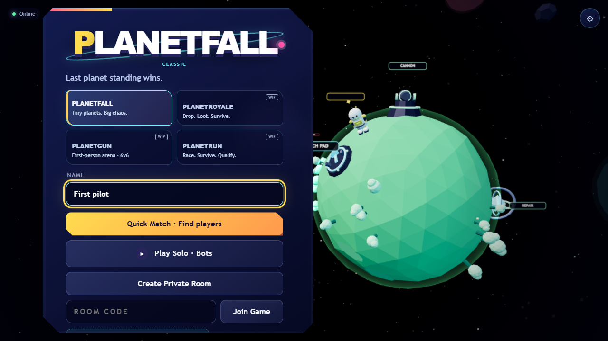
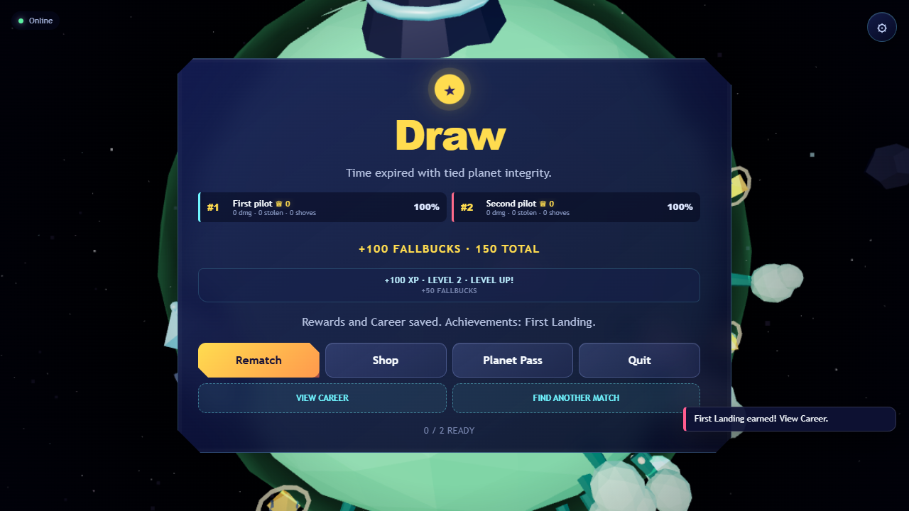
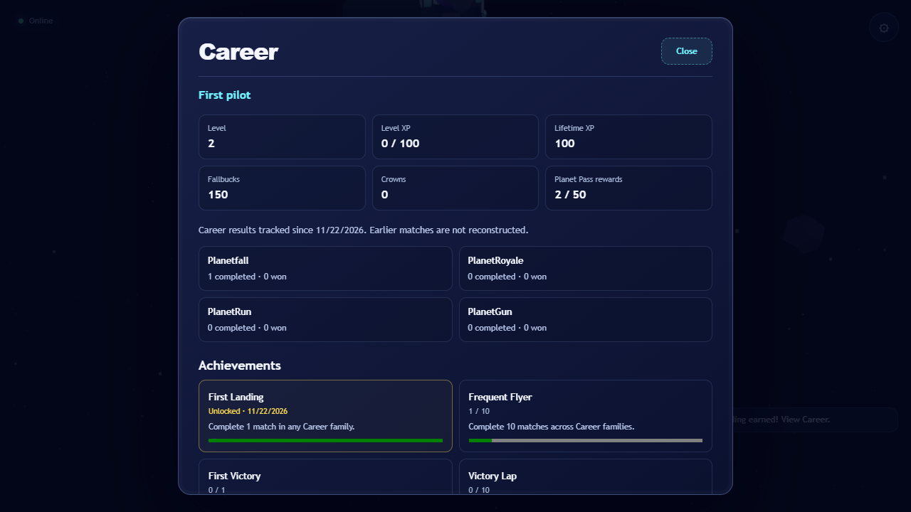

# PLANETFALL

[](https://github.com/chrisriv10/Planetfall/stargazers)
[](https://nodejs.org/)
[](https://www.typescriptlang.org/)
[](https://vite.dev/)
[](https://threejs.org/)
[](https://socket.io/)

Tiny planets. Big chaos. Planetfall is an online 3D space party game with four playable game families, bots, shared cosmetic progression, and an authoritative multiplayer server.

**[Play in your browser](https://planetfall.pages.dev)** · **[Windows releases](https://github.com/chrisriv10/Planetfall/releases)** · **[Hosting guide](docs/DEPLOYMENT.md)**



*Actual browser capture from the local release validation build. PlanetRoyale, PlanetRun, and PlanetGun are playable works in progress.*

## Choose your orbit

| Family | What you play |
| --- | --- |
| **Planetfall** | Classic and Chaos for 2–6 pilots on destructible tiny planets. Collect Scrap, fire cannons, raid rivals, grapple between worlds, and repair your planet. Last planet standing wins. |
| **PlanetRoyale** | Solo, Duo, and Squad battle royale on Orbital Isle. Private rooms support 10, 20, or 40 participants with optional bot fill. Drop from the Starliner, loot weapons and utilities, survive the Void, and revive crewmates. |
| **PlanetRun** | An orbital obstacle tournament for up to 30 pilots, with six themed rounds and bot fill. Run, jump, dive, and qualify for the next round. |
| **PlanetGun** | First-person Team Deathmatch, round-based PlanetStrike and PlanetSiege, hero-based PlanetWatch, and cooperative PlanetZombies for up to four survivors. |

## Start playing

1. Open [Planetfall](https://planetfall.pages.dev), choose a family, and enter a pilot name.
2. For Classic, choose **Quick Match · Find players** to enter a public lobby. Ready up; the host starts when everyone is ready. After a short wait, the host can choose **Start with bots**. Bots are optional and are not presented as human players.
3. Choose **Play Solo · Bots** for solo practice, or **Create Private Room** and share its room code or invite link with friends. Private rooms stay separate from public matchmaking.
4. Open **How to play** for objectives, controls, common mistakes, and submode guidance. Contextual hints can be dismissed, skipped per family, or disabled and re-enabled.

Public Quick Match currently serves **Planetfall Classic**. The other families use their own solo/private-room flows. A quiet public lobby may have no other humans available; searches end after five minutes.

### Progression and Career

Earn XP, Crowns, and Fallbucks across all four families. The Shop offers cosmetics, and the **50-level Planet Pass** unlocks rewards as you progress. Cosmetics do not grant gameplay advantages.

**Career** is your private summary of level, XP, currencies, Pass rewards, and completed results by family. Its **13 achievements** recognize milestones such as your first completed match, repairs, victories, qualifications, and eliminations. Achievements award recognition only; they do not change currency, XP, or equipment. Career starts with newly tracked results and does not reconstruct earlier matches.



*A completed Classic validation match: the authoritative result saved rewards and unlocked First Landing.*



*The same local validation profile in Career, showing saved progression and an earned achievement.*

### Guests and browser accounts

You can play as a guest. The device keeps a private guest credential; the server owns the saved progression. Keep the same browser or desktop app data to return to that guest profile. Clearing it or changing devices starts a different guest unless the profile was linked to an account.

In the **browser**, open **Account** from Home or Settings to sign in with Google when accounts are enabled by the host. First sign-in can link guest progression. If both the account and this device already have progress, choose which profile to play; their balances are kept separate. Google accounts recover progression across browsers and sync supported controls and Combat Kit preferences. Graphics and audio settings stay local.

Career is private. The global XP leaderboard is a separate, opt-in feature. See [saved profiles and accounts](docs/PLAYER_PROFILES.md) for storage, ownership, and persistence details.

### Windows desktop

The Electron desktop app opens the online game and uses the same live multiplayer server. Install from a **published Windows release** when available, or build the installer locally using the commands below. The installer targets Windows x64.

The initial desktop app supports **persistent guest play**. Google sign-in and guest-to-account linking are **browser-only**; desktop account sign-in is not supported yet. Desktop and browser guest profiles are separate. Internet access is required.

Windows builds are currently unsigned, so Windows SmartScreen may show an unrecognized-app warning. Automatic updates are not implemented; install a newer release manually.

## Controls

Keyboard, mouse, and standard gamepads are supported. **How to play** and the HUD show the active family's controls, including supported custom bindings.

| Classic action | Keyboard and mouse | Gamepad |
| --- | --- | --- |
| Move / camera | `WASD` / mouse | Left / right stick |
| Jump | `Space` | `A` |
| Burst / cancel | `Shift` / `Esc` | `B` |
| Launch, shove, or jam | `E` | `X` |
| Fire cannon / grapple | Left / right click | `RT` / `LT` |
| Repair | `R` | `RB` |
| Switch cannon weapon | `Q` | `Y` |
| Cycle targets | Mouse wheel | `LB` / `RB` |
| Emote selector | Hold `V` + move | Hold D-pad up + left stick |
| Expand player board | Hold `Tab` | Hold View |
| Match menu | `Esc` | Menu |

Nearby structure prompts show available Scrap utilities. Use `E` / `X` for shields or cannon overcharge, and `R` / `RB` at a launch pad for a launch boost. Aim at a nearby astronaut before grappling to create a short player tether.

PlanetRoyale adds sprint (`Shift` / `B`), slide (`Ctrl` / right-stick click), inventory slots (`1–5` / `Y`), reload (`R` / `RB`), and tactical map (`M` / D-pad down). Jump from the Starliner with `Space` / `A`; Ion Wings deploy automatically near the island.

PlanetRun uses `Space` to jump and `Shift` to dive. PlanetGun uses left click to fire, right click to aim, `R` to reload, and `1` / `2` to select weapons. Mode-specific equipment, abilities, and interactions appear in the HUD.

## Run locally

Requires **Node.js 22.x** and **npm 10 or newer**. Run commands from the repository root.

```bash
npm ci
npm run dev
```

Open the client address printed by Vite (normally `http://localhost:5173`). The command builds the shared workspace and runs the shared watcher, authoritative server, and client together.

Build all three workspaces and run the production server:

```bash
npm run build
npm start
```

Serve `client/dist` separately as a static site, with `VITE_SERVER_URL` set to the server's public origin at client build time. `npm start` runs the multiplayer server; the hosting guide covers the complete client/server setup.

For the Windows desktop shell and installer:

```bash
npm run desktop:install
npm run desktop:dev
npm run desktop:test
npm run desktop:dist
```

The desktop shell loads the canonical HTTPS game; it is not an offline copy of the server. Build the Windows NSIS installer on Windows. Packaging and manual release checks are documented in [desktop/README.md](desktop/README.md).

## Architecture and hosting

Planetfall is a TypeScript npm workspace:

| Area | Responsibility |
| --- | --- |
| `client/` | Vite browser app, Three.js rendering, Rapier integration, input, prediction, and UI |
| `server/` | Express and Socket.IO service; authoritative rooms, physics, match results, progression, and purchases |
| `shared/` | Shared contracts, types, balance rules, maps, and progression definitions |
| `desktop/` | Electron online shell and Windows packaging |

The browser client is hosted on **Cloudflare Pages** and connects to the authoritative **Render** server. Active rooms and presence live in one server process. Durable profile progression uses **PostgreSQL**, with server-validated transactions and operation receipts for saved rewards and purchases. Optional browser Google accounts use Neon Managed Auth and the account proxy.

For your own deployment, configure `VITE_SERVER_URL` for the client, `CLIENT_ORIGIN` for the server, and a restricted server-only `DATABASE_URL`. Prepare the database with the explicit migration procedure before starting the service. Development without PostgreSQL uses a local profile file; an ephemeral hosted filesystem cannot provide durable saves.

Follow [deployment settings](docs/DEPLOYMENT.md), [profile storage and migrations](docs/PLAYER_PROFILES.md), and the [production cutover runbook](docs/RELEASE_CUTOVER.md). Database credentials and migration-owner credentials must never enter a client build.

## Validation

```bash
npm run typecheck
npm run build
npm test
npx playwright install chromium
npm run test:e2e
```

Focused browser suites are also available:

```bash
npm run test:e2e:experience
npm run test:e2e:career-accounts
```

CI runs install, typecheck, build, and unit/integration tests on pushes and pull requests to `main`. The standard browser suite runs locally on dedicated ports 15173 and 13000. Hosted checks use a separate production configuration; local tests alone do not establish production account or database readiness.

## Current limits

- PlanetRoyale, PlanetRun, and PlanetGun display a work-in-progress notice. Their gameplay, balance, and presentation continue to evolve.
- Rooms disappear when the server restarts. The current deployment uses a single authoritative instance; room state and presence are not shared across multiple instances.
- A sleeping Free Render service can take roughly a minute to wake. Match availability depends on the online server and the players currently connected.
- Saved progress requires working durable storage. Uncommitted rewards queued during a database outage can be lost if the server is forcibly stopped; see the persistence runbook.
- Desktop currently has guest play only, no automatic updates, and no code signing. Mobile/touch play and offline play are not supported release targets.

## Credits

Created by [chrisriv10](https://github.com/chrisriv10).

Menu music: **“Low Battery”**. Match music: **“Bot City”**. Both are from [My Little Bots](https://davidkbd.itch.io/my-little-bots-crazy-music-for-robots-asset-pack) by **David KBD**, used under [CC BY 4.0](https://creativecommons.org/licenses/by/4.0/) without changes to the audio files.

See [third-party notices](THIRD_PARTY_NOTICES.md) for attribution details.
