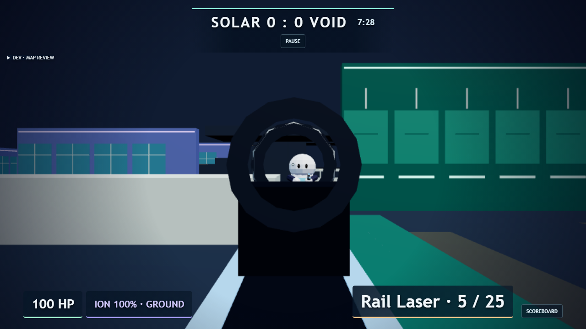
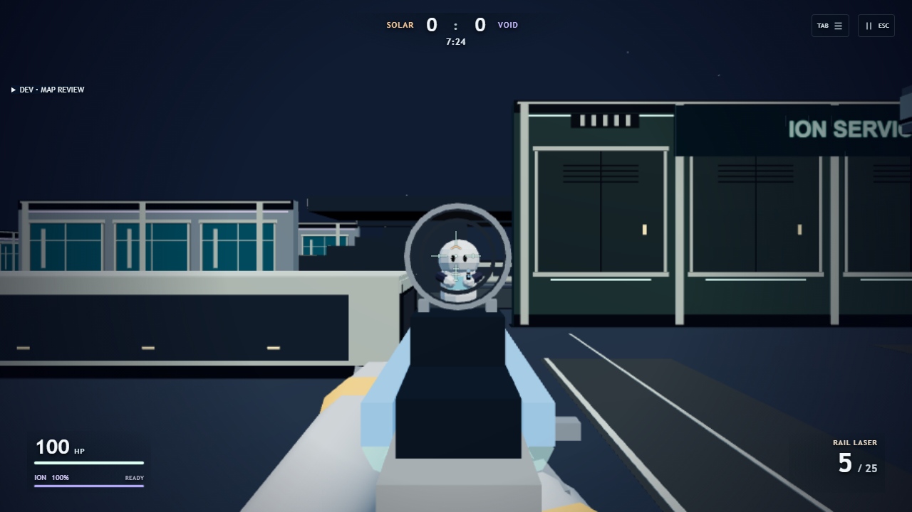

# PlanetGun visual quality pass — October 23, 2026

Initial HEAD: `a638f8397adb9b6a465de5dd48af49f5bcfab044` (`main`). Tracked files were clean when this pass began; 3,996 pre-existing untracked evidence files were preserved. No reset, restore, stash, checkout replacement or pull was used. Work ran on `DESKTOP-JL99F36`. This report covers the latest PlanetGun presentation request, not a new certification of the older BR recovery backlog.

## Screenshot comparison

The before image is the supplied checkpoint reference. The after image uses two actual opposing clients, the same southern passage, Rail Laser, held ADS and an enemy at comparable range. Both clients walk there using keyboard input; neither is teleported. The scoped shot then registers against the other authoritative client.

| Before | After |
| --- | --- |
|  |  |

## Viewmodels and ADS

- Rail local scale: `.43 → .34`; settled ADS rig depth: `-.29 → -.50`. Canonical third-person weapons remain unchanged. Receiver cheeks, thermal slots, lower rail channels, bolt tab and optic mount expose the original energy-weapon structure.
- The near-camera stock is shortened locally. The receiver keeps dark armor alongside lighter metallic framing rather than becoming a uniformly gray gun.
- Rail optic diameter at 1280×720 / 34° FOV is about 152px, previously about 290px: approximately 12% versus 23% of viewport width. This is optic diameter, not a claim about total pixel occlusion. The silver rear lip is thin; forward rims use darker metal, with transparent glass at opacity `.045`. Center and surrounding precision rays remain unobstructed.
- Segmented astronaut sleeves, cuffs, palms, knuckles, fingers and thumbs support each weapon at separate grip/foregrip positions. Equipped suit accents color the cuffs. Long-gun support and trigger wrists expose knuckles beside the receiver; Comet retains its compact grip.
- All six local weapons have distinct scale, hip/ADS depth, recoil, sprint cant and reload movement. Reload moves the support hand; switch and ADS poses interpolate. The authoritative aim direction, FOV profiles, spread, damage, weapon timing and movement were preserved.
- A separate viewmodel scene uses a soft hemisphere and restrained directional key. It cannot light the arena. A depth-only clear places the viewmodel over the world; renderer flags are restored and both passes are included in counters.
- Local muzzle flashes follow the active weapon's canonical emitter through the actual hip/ADS/recoil/reload transforms into camera-local space. They no longer remain at a legacy fixed camera offset. Authoritative shot origins and directions are unchanged.

## Nova Block environment

- Common off-white / blue-gray habitat shells replace unrelated building colors. Dark structural reveals, sills, pilasters, mullions, glass reflections, coping, roof fascia, ventilation crowns and entrance strips give the walls depth.
- The former green rectangle is the collision-backed `service-run-east` wall-run structure, not an enclosed building. It now reads as ION SERVICE / 04 with framed maintenance bays, vents, status lamps and a continuous smooth running face. Its shallow dressing projects under 4cm.
- Utility and transit cover have framed machinery panels, bases, caps, vents and status marks on both Z and X faces. A live traversal review caught the initially blank ticket-bank flank; the final version dresses that side too.
- Flat teal foreground polygons were paving/wayfinding inlays, not ramps. Their broad saturated surfaces became restrained neutral route bays with thin guide edges. Thin contact bands ground actual solids; hydroponic planting stays within existing trays.
- Major signs identify Solar Habitat, Void Observatory, Hydroponics, Transit, Maintenance and Ion Service. Four sign planes were moved in front of new facade layers; tests keep signs backed by opaque wall spans, away from entrances.
- A visible horizon planet, small star field, distant skyline and open station arcs establish the orbital setting. Planet/stars/station identity remains on Low. Detail uses shared materials and instanced geometry, with no per-fixture dynamic lights.
- World lighting uses a warm key, cool opposite fill and controlled hemisphere contribution. Only High enables a 1024² sun shadow map for major bodies and two major remote astronaut meshes. Low/Medium/Auto use contact bands and layered architecture without that shadow pass.
- All authoritative body positions and dimensions are unchanged. No server/shared/collision/navigation/balance code changed.

## HUD

- Centered compact team score and timer; the arbitrary long top rule and center Pause button are gone.
- HP and Ion use short bars with readable values and concise movement states. Ammo is the dominant lower-right value; weapon name and reserve are secondary.
- Small edge Pause / Scoreboard buttons retain keyboard and clickable access. They no longer dominate the FPS view.
- Original category hip references react to the game's current spread. Rail/Quasar use precision ticks and an energy chevron; Pulse/Nova use lighter brackets. Reticle center remains at viewport center and crossfades late in ADS.
- DEV map review and both DOM/live diagnostic interfaces are gated by `import.meta.env.DEV`. A separate test runs actual production assets and checks their absence while firing and leaving a match still work.

## Actual play and visual review

Native browser input exercised four- and twelve-player bot matches, shots/reload, respawn, pause/settings/cursor release and leave-to-home. A separate two-client room was used to inspect traversal without incoming bot fire. The route log records actual positions with `review: null`, including west entrance, stairs to y=3.5, central circulation, a real `mantle` state followed by supported y=1.3, service-wall contact/running, east entrance and east gallery.

The center DEV review anchor is immediately behind the existing mantle plinth and under the crossover corner, so that static view naturally contains large near cover. The same obstruction is present in the previous checkpoint. Live plaza traversal was reviewed separately; no camera-only evidence was treated as traversal acceptance.

The final gallery includes Pulse hip/ADS, Rail hip/ADS, Nova, Photon, Quasar, Comet, recoil/reload/sprint poses, compact viewport HUD, center/upper plaza, both habitat interiors, Hydroponics, Solar/Void spawns and wall-run route. Reviews cover Low, Medium, High and Auto. The supplied Rail composition was recreated directly and compared above.

Stair side walls and broad roof/deck surfaces remain deliberately quiet. They retain competitive silhouettes and avoid introducing false cover. This was agent-driven play and screenshot inspection; it is not a claim that a human has accepted the art or that every hardware configuration has been tested.

### Curated review gallery

| Subject | Evidence |
| --- | --- |
| Pulse Rifle | [Hip](after/pulse-hip.png) · [ADS](after/pulse-ads.png) |
| Rail Laser | [Hip](after/rail-hip.png) · [Recreated opposing-client ADS](after/rail-held-ads.png) |
| Other weapons | [Nova](after/nova-hip.png) · [Photon](after/photon-hip.png) · [Quasar ADS](after/quasar-ads.png) · [Comet](after/comet-hip.png) |
| Animated poses | [Rail recoil](after/rail-recoil.png) · [Reload](after/rail-reload.png) · [Sprint](after/rail-sprint.png) |
| Compact viewport | [864×540 HUD](after/compact-hud-864.png) |
| Central circulation | [Live player-height plaza](after/native-plaza-live.png) · [Upper plaza](after/high-upper.png) |
| Interiors | [Solar habitat](after/high-westInterior.png) · [Void observatory](after/high-eastInterior.png) |
| Flanks | [Hydroponics](after/high-left.png) · [Wall-run route](after/high-wallRun.png) |
| Team spawns | [Solar](after/high-solar.png) · [Void](after/high-void.png) |
| Actual traversal | [West stairs/gallery](after/native-west-gallery.png) · [Supported equipment top](after/native-utility-top.png) · [Service wall run](after/native-service-wallrun.png) |
| Orbital context | [Live upper-route lookback](after/native-upper-lookback.png) · [Overhead](after/high-overhead.png) |

Preset comparisons: [Low upper route](after/low-upper.png), [Medium habitat](after/medium-westInterior.png), [Auto wall-run route](after/auto-wallRun.png).

Raw native timing windows: [before](before/client-render-samples.json), [after](after/client-render-samples.json). Actual input route: [state log](after/manual-route.json). Scoped combat: [two-client state](after/scoped-combat.json).

## Performance method and limits

Baseline was served from a separate archive of initial HEAD, sharing unchanged assets/dependencies, without replacing the current working tree. Final after-samples were refreshed after the muzzle-anchor correction and after all automated workers stopped. Both builds used the native browser's actual RTX 3060 / D3D11 renderer at 1280×720, with 12 participants (one local player and 11 active bots), the same five views and all four requested settings.

Each window settled for about 2.1 seconds and sampled the most recent 90 frame times. ADS was held for four seconds and the diagnostic value was verified near 1.0. All recorded samples are in the `playing` phase. Combat samples are the `right` camera during live bot combat, not an empty scene. Bot positions/effects vary, so last-frame draw/triangle counters are indicative rather than a deterministic delta benchmark.

FPS is display-limited at about 60 on this machine. Median and p95 stayed about 16.7 / 16.8ms before and after. The richer shell costs more triangles; no FPS speedup is claimed. Low removes secondary vents/joints/skyline/hologram, shortens player detail range and reduces internal resolution; Medium balances detail; High adds limited shadows; Auto resolved to Medium in these measurements. Manual choices continue to override Auto.

`visibleInstances` and `materialCount` count scene objects marked visible, including ones later rejected by frustum culling; they are not GPU visibility-query results. Calls/triangles include the full world and viewmodel passes, including High shadows. Geometry/texture counts include renderer caches. Raw frame arrays and renderer metadata are in the two JSON files.

| Quality | Scene | Calls before → after | Triangles before → after | Instances before → after | Materials before → after | Median / p95 ms, after |
| --- | --- | ---: | ---: | ---: | ---: | ---: |
| low | quiet-exterior | 238 → 363 | 57894 → 81594 | 2296 → 3595 | 86 → 96 | 16.7 / 16.8 |
| low | dense-exterior | 231 → 181 | 57584 → 69794 | 2304 → 3583 | 98 → 75 | 16.7 / 16.8 |
| low | interior | 270 → 295 | 58768 → 75822 | 2296 → 3595 | 86 → 95 | 16.7 / 16.8 |
| low | rail-ads | 144 → 156 | 51080 → 64532 | 2284 → 3587 | 73 → 94 | 16.7 / 16.8 |
| low | active-firefight | 102 → 192 | 49666 → 70170 | 2280 → 3595 | 61 → 92 | 16.7 / 16.8 |
| medium | quiet-exterior | 310 → 365 | 68646 → 89258 | 2709 → 4236 | 94 → 94 | 16.7 / 16.8 |
| medium | dense-exterior | 214 → 239 | 62514 → 81160 | 2705 → 4228 | 94 → 81 | 16.7 / 16.8 |
| medium | interior | 254 → 307 | 62922 → 84714 | 2705 → 4236 | 94 → 91 | 16.7 / 16.8 |
| medium | rail-ads | 153 → 290 | 56986 → 81168 | 2701 → 4240 | 93 → 112 | 16.7 / 16.8 |
| medium | active-firefight | 218 → 169 | 62598 → 75972 | 2709 → 4232 | 91 → 90 | 16.7 / 16.8 |
| high | quiet-exterior | 311 → 449 | 68016 → 96184 | 2709 → 4236 | 105 → 106 | 16.7 / 16.8 |
| high | dense-exterior | 181 → 254 | 59946 → 83884 | 2697 → 4232 | 90 → 94 | 16.7 / 16.8 |
| high | interior | 298 → 347 | 64860 → 89702 | 2709 → 4236 | 112 → 96 | 16.7 / 16.8 |
| high | rail-ads | 329 → 377 | 66122 → 88612 | 2709 → 4244 | 117 → 131 | 16.7 / 16.8 |
| high | active-firefight | 80 → 191 | 53444 → 79526 | 2701 → 4228 | 97 → 82 | 16.7 / 16.8 |
| auto | quiet-exterior | 246 → 428 | 64754 → 92606 | 2705 → 4236 | 93 → 100 | 16.7 / 16.8 |
| auto | dense-exterior | 158 → 239 | 59480 → 81160 | 2709 → 4236 | 106 → 100 | 16.7 / 16.8 |
| auto | interior | 215 → 290 | 60936 → 84178 | 2709 → 4240 | 97 → 102 | 16.7 / 16.8 |
| auto | rail-ads | 166 → 390 | 57660 → 86376 | 2701 → 4236 | 92 → 107 | 16.7 / 16.8 |
| auto | active-firefight | 114 → 138 | 55954 → 74034 | 2693 → 4240 | 69 → 108 | 16.7 / 16.8 |

## Validation

- `npm run typecheck`: passed for client, server and shared.
- `npm run build`: passed; the existing large shared/Rapier chunk warning remains. The warning limit was not changed.
- `npm test`: **1,442 tests / 279 files passed**, including unchanged gameplay, collision, server-performance and cross-mode ownership coverage.
- `npm run test:e2e -- --workers=1`: **34 / 34 passed** in 20.9 minutes across Classic, BR lobby, PlanetRun and PlanetGun.
- `npm run test:e2e -- --config playwright.production.config.js --workers=1`: **1 / 1 passed** against actual production assets. DEV controls/outputs were absent; fire, pointer-lock release and leave-to-home worked without page errors. [Production screenshot](after/production-fps.png).

Saved final logs: [typecheck](typecheck.txt), [build](build.txt), [1,442 tests](tests.txt), [34 E2Es](e2e.txt), [production E2E](production-e2e.txt).

The first default E2E attempt used six simultaneous software-WebGL workers and saturated this PC, producing cross-mode timeouts and delaying shell commands. It was interrupted and the complete suite was restarted with one worker. No tests were filtered from that final run; no assertion, timeout, clearance condition or performance budget changed.

An initial two-client test failed before firing because its correction loop read the diagnostic DOM, which refreshes every 500ms. The test now uses a read-only live DEV diagnostic function, preserving its route, tolerances, timeouts and shot assertions. The focused two-client run then passed. No gameplay conditions, performance budgets or assertions were weakened.

The new held-pose gallery initially used bots; a bot elimination during capture reset ammo and invalidated the firing assertion. Pose/production presentation checks now use two actual clients with a passive second player and no bots. Existing live bot gameplay and opposing-client combat coverage remains separate and unchanged. The full E2E suite was restarted after correcting this setup race.

The pose driver also holds the actual fire button until the unchanged magazine-decrease assertion observes server acknowledgement, before taking its recoil capture. This avoids releasing a 110ms test pulse while software-rendered capture stalls a frame. It does not lengthen an input buffer, timeout or firing window in the game.

The existing Classic raid driver also reproduced a return-pad intent race: after combat, the visible action remained `SHOVE NOVA` instead of `LAUNCH`. The driver now explicitly turns toward each launch pad after reaching it, using the existing real mouse-aim helper, just as it already does for repair-station interaction. Launch/shove/range/feed assertions and all time limits are unchanged. No Classic gameplay code changed.

No external assets or new dependencies were added. No deployment command or hosting action was run. The user authorized commit/push after this validation checkpoint.
